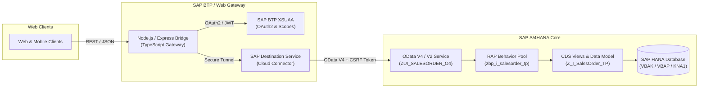

# SAP S/4HANA & ABAP Integration

[](https://www.sap.com/products/technology-platform.html)
[](https://www.sap.com/products/erp/s4hana-erp.html)
[](https://www.odata.org/)
[](https://help.sap.com/)
[]()

Enterprise reference architecture demonstrating integration between SAP S/4HANA (ABAP Core Data Services & RAP), SAP Business Technology Platform (BTP), and web architectures via OData services.

---

## Architecture Overview



---

## Repository Structure

```text
sap-s4hana-abap-integration/
├── abap/
│   ├── cds/
│   │   ├── z_i_salesorder_tp.ddls
│   │   ├── z_c_salesorder_tp.ddls
│   │   └── z_i_salesorderitem.ddls
│   ├── srv/
│   │   └── zui_salesorder_o4.srvd
│   ├── bdef/
│   │   └── z_i_salesorder_tp.bdef
│   ├── classes/
│   │   ├── zbp_i_salesorder_tp.clas.abap
│   │   ├── zcl_sales_odata_dpc_ext.clas.abap
│   │   └── zcl_salesorder_unittest.clas.abap
│   └── .abapgit.xml
├── btp/
│   ├── mta.yaml
│   ├── xs-security.json
│   └── destinations.json
├── web-backend/
│   ├── src/
│   │   ├── services/sapOdataClient.ts
│   │   ├── controllers/salesOrderController.ts
│   │   ├── routes/apiRoutes.ts
│   │   └── index.ts
│   ├── tests/
│   │   └── sapOdataClient.test.ts
│   └── package.json
├── INTERVIEW_CHEATSHEET.md
└── README.md
```

---

## Technical Implementations

### 1. ABAP Core Data Services (CDS) & RAP Model
- Interface views (`Z_I_SalesOrder_TP`) utilizing SAP S/4HANA tables (`VBAK`, `VBAP`, `KNA1`) with native currency and quantity semantics (`@Semantics.amount.currencyCode`).
- Business Object Behavior Definition with:
  - Validation on Save: `validateCustomer` ensuring referential integrity before committing to database.
  - Determination on Modify: `calculateTotalAmount` recalculating header gross totals dynamically upon line item insertion/update.
  - Instance Custom Action: `setOrderCompleted` performing business state transitions.

### 2. SAP Gateway & OData Handshake
- CSRF Protection handling (`X-CSRF-Token: Fetch` handshake + session cookie reuse).
- Dual OData support: OData V4 via RAP Service Bindings and OData V2 via traditional `/IWBEP/CL_MGW_ABS_DATA` inheritance (`DPC_EXT`).

### 3. SAP BTP Cloud Architecture
- `mta.yaml` Multi-Target Application standard for deploying Node.js services to SAP BTP Cloud Foundry.
- Bound to XSUAA (`xs-security.json`) for RBAC authorization (`SalesOrderViewer`, `SalesOrderManager`) and SAP Connectivity Service for Cloud Connector tunneling.

### 4. Software Testing & Quality Assurance
- ABAP Unit (AUnit): In-memory test methods validating EML operations, data constraints, and business logic assertions in Eclipse ADT.
- Web Backend Automated Tests: Jest test suite testing token acquisition, payload transformations, error responses, and mock fallback.

---

## Running the Web Backend Bridge

```bash
cd web-backend
npm install
npm test
npm start
```

### Health Check Endpoint
```bash
curl http://localhost:3000/health
```

### Fetch Sales Orders via Integration Gateway
```bash
curl http://localhost:3000/api/v1/sap/orders
```

### Complete a Sales Order
```bash
curl -X POST http://localhost:3000/api/v1/sap/orders/0000000010/complete
```

---

## CV / LinkedIn Project Description

> **SAP S/4HANA & ABAP Integration (2026)**
> *ABAP | OData | SAP BTP | Eclipse | SAP S/4HANA*
> - Developed foundational OData services (V4 & V2) and ABAP programs using CDS Views and the ABAP RESTful Application Programming Model (RAP) to bridge modern web backend architectures with SAP S/4HANA.
> - Navigated SAP S/4HANA and SAP BTP Cloud Foundry environments, configuring Multi-Target Applications (MTA), XSUAA security profiles, and Destination services.
> - Applied enterprise software testing methodologies including ABAP Unit (AUnit) and automated integration testing, deploying clean ABAP logic via Eclipse ADT and abapGit.
